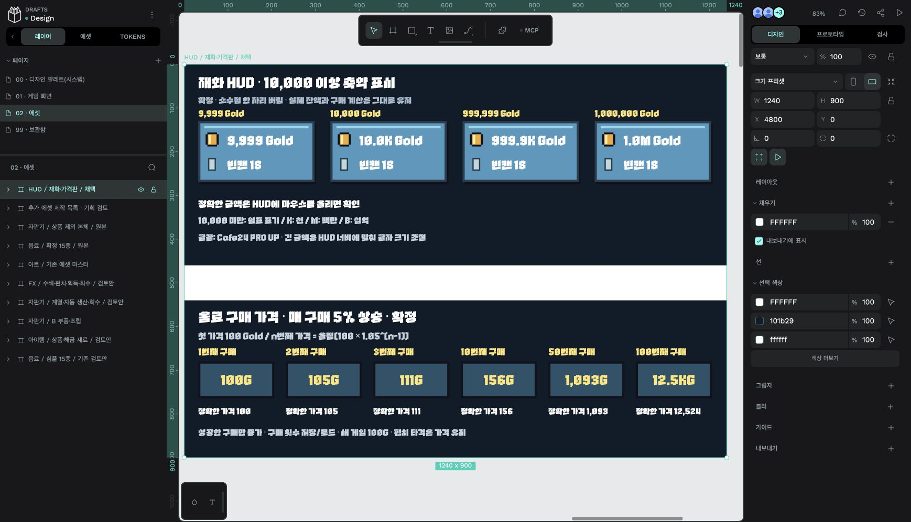

# Penpot 페이지·에셋 정리 · 2026-10-20

사용자 확정에 따라 기존 파일을 아래 4개 페이지로 정리했다. 디자인 SSOT는 Penpot, 작업 준수사항은 [DESIGN.md](../../DESIGN.md#디자인-작업-준수사항)다. Penpot 작성 규칙 보드와 Text 27개는 제거했다. 게임 코드·화면의 외형·기획 수치 변경은 포함하지 않는다.

| 페이지 | 현재 위치·내용 |
| --- | --- |
| [00 · 디자인 팔레트(시스템)](https://design.penpot.app/#/workspace?team-id=ce180602-f36b-8035-8008-cda23f0a1b46&file-id=cd444aaf-0d8c-801b-8008-cda246e18650&page-id=490e660f-738c-80e7-8008-d0f0d410a6b5&layout=layers) | 공통 가격 버튼과 능력·피버·해금·버튼 상태 마스터. 새 팔레트나 토큰을 확정·생성한 작업은 아니다. |
| [01 · 게임 화면](https://design.penpot.app/#/workspace?team-id=ce180602-f36b-8035-8008-cda23f0a1b46&file-id=cd444aaf-0d8c-801b-8008-cda246e18650&page-id=55aeaacb-aa46-80be-8008-cdca4fa29ef0&layout=layers) | 기존 메인·해금·상태 보드, Play 스타일 채택 화면 2개, 미확정 크기 비교안. |
| [02 · 에셋](https://design.penpot.app/#/workspace?team-id=ce180602-f36b-8035-8008-cda23f0a1b46&file-id=cd444aaf-0d8c-801b-8008-cda246e18650&page-id=78528b83-c102-8057-8008-cec032c8f181&layout=layers) | 음료·아이템·자판기·부품·FX·HUD·제작 목록. 확정 음료와 기존 검토안을 이름으로 구분했다. |
| [99 · 보관함](https://design.penpot.app/#/workspace?team-id=ce180602-f36b-8035-8008-cda23f0a1b46&file-id=cd444aaf-0d8c-801b-8008-cda246e18650&page-id=6587dfe1-cdcc-8063-8008-cfe00be50226&layout=layers) | 이전 능력 목록·통합·패널·정보 카드·시간대 비교안, 사용자 러프와 통합 이미지 보존본. |

## 자주 사용하는 원본

- [HUD / 재화·가격판 / 채택](https://design.penpot.app/#/workspace?team-id=ce180602-f36b-8035-8008-cda23f0a1b46&file-id=cd444aaf-0d8c-801b-8008-cda246e18650&page-id=78528b83-c102-8057-8008-cec032c8f181&board-id=6d00bd1a-d292-8094-8008-d0fa8c37e600&layout=layers): 기존 골드 축약·가격판 그룹을 한 보드로 묶었다.
- [확정 음료 15종](https://design.penpot.app/#/workspace?team-id=ce180602-f36b-8035-8008-cda23f0a1b46&file-id=cd444aaf-0d8c-801b-8008-cda246e18650&page-id=78528b83-c102-8057-8008-cec032c8f181&board-id=6d00bd1a-d292-8094-8008-d0f9484645ce&layout=layers).
- [가격 버튼 A 마스터](https://design.penpot.app/#/workspace?team-id=ce180602-f36b-8035-8008-cda23f0a1b46&file-id=cd444aaf-0d8c-801b-8008-cda246e18650&page-id=490e660f-738c-80e7-8008-d0f0d410a6b5&board-id=6d00bd1a-d292-8094-8008-d0f8e64f5a10&layout=layers).
- [Play 스타일 채택 원본](https://design.penpot.app/#/workspace?team-id=ce180602-f36b-8035-8008-cda23f0a1b46&file-id=cd444aaf-0d8c-801b-8008-cda246e18650&page-id=55aeaacb-aa46-80be-8008-cdca4fa29ef0&board-id=6d00bd1a-d292-8094-8008-d0f99d5e0b52&layout=layers).
- [크기 비교안 · 미확정](https://design.penpot.app/#/workspace?team-id=ce180602-f36b-8035-8008-cda23f0a1b46&file-id=cd444aaf-0d8c-801b-8008-cda246e18650&page-id=55aeaacb-aa46-80be-8008-cdca4fa29ef0&board-id=6d00bd1a-d292-8094-8008-d0fa07b44d51&layout=layers).

## 이동과 검증

- 페이지 순서 00 / 01 / 02 / 99, 최상위 객체 34개, 컴포넌트 120개, 등록 색상 0개, 타이포그래피 1개를 원본에서 확인했다.
- 전체 객체 6,509개 → 6,482개. 규칙 보드·텍스트 28개 제거와 HUD 묶음 보드 1개 추가에 따른 차이다. 크기 비교안은 구성 요소별 이동 후 같은 656개 객체로 재조립했다.
- 각 이동의 하위 객체 수와 마스터 컴포넌트 ID를 원본·이동본의 클립보드 구조로 대조했다. 마스터 120개가 존재하고 일반 연결 복사본 21개의 원본 참조가 정상이다. 마스터 내부의 중첩 복사본 106개도 컴포넌트 정의를 찾는다.
- 기존 02·04·06 페이지는 내용을 옮기고 비어 있음을 확인한 뒤 제거했다. 기존 03을 현재 02로, 기존 05를 99로 사용한다. 최상위 `svg` 그룹은 역할·채택 상태로 이름을 바꿨다. 기존 SVG 원시 도형·문구를 네이티브 Text로 다시 만드는 작업은 포함하지 않는다.
- 이동 도중 대용량 클립보드 전송이 중단되어, 사용자 승인 후 작업 직전 저장 버전으로 복원하고 다시 진행했다. 최종 이동은 같은 파일에서 이미 존재하는 이미지 참조를 유지하며 이미지 사본을 재전송하지 않았다. [Penpot의 동일 파일 붙여넣기 처리](https://github.com/penpot/penpot/blob/develop/frontend/src/app/main/data/workspace/clipboard.cljs#L585)를 따른다.

## 산출물과 과거 기록

- `manifest.json`: 현재 페이지·보드 ID, 위치, 객체 수와 라이브러리 목록.
- `moves.json`: 이동 전후 객체 ID, 페이지, 하위 객체·컴포넌트 보존 확인. 페이지 간 이동으로 객체 ID는 바뀌었고 컴포넌트 ID는 유지했다.
- `penpot-hud-organized.jpg`: 편집기에서 확인한 실제 글꼴·HUD·페이지 순서. `penpot-size-organized.jpg`: 크기 비교안 재조립 검수.
- `hud-current.svg`: 정리된 HUD 보드의 벡터 내보내기. 글꼴 표시에는 Cafe24 PRO UP이 필요하므로 외부 뷰어와 편집기 캡처를 구분한다.
- 과거 README·생성 스크립트·manifest의 Y 좌표와 ID는 작성 당시 기록이다. 현재 위치는 이 문서와 현재 manifest를 우선하며, 기존 생성 스크립트는 대상 ID를 다시 확인하기 전 재실행하지 않는다.

