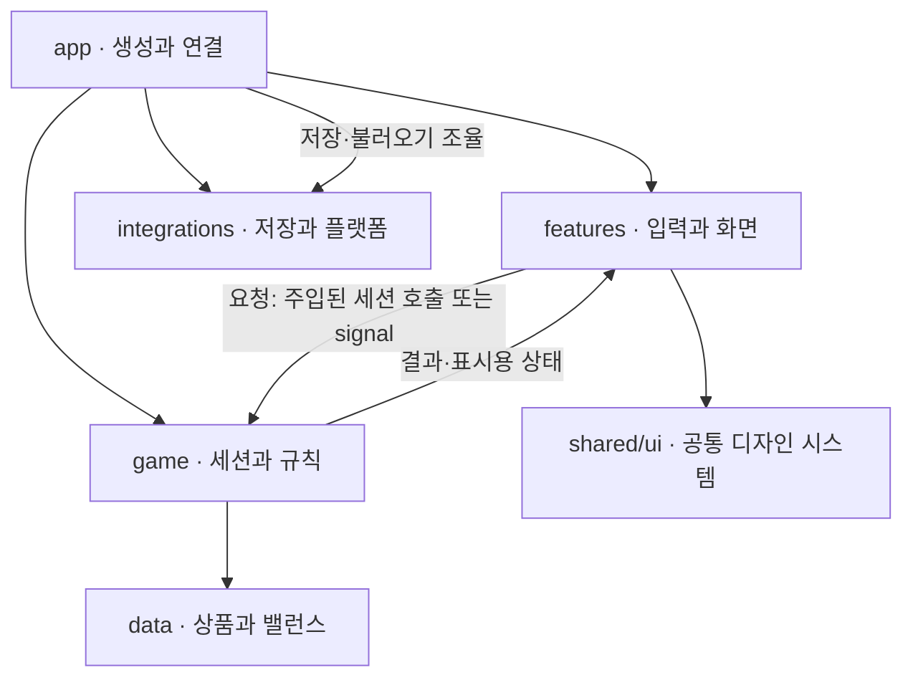

# 06. 목표 폴더 구조·아키텍처

이 문서는 앞으로 지향할 구조와 파일 배치 기준이다. 현재 파일 위치는 [코드 안내](07-codebase-guide.md)에서 확인한다. 아래 폴더와 파일은 목표 구조의 예시이며 아직 생성·이동하지 않았다. 실제 기능 개발·리팩터링에서 필요한 부분부터 적용하고 빈 폴더나 미사용 기반 코드를 미리 만들지 않는다.

## 설계 원칙

- **기능별로 모은다.** 한 화면·기능의 씬, 스크립트, 전용 리소스는 가까이 둔다. `scenes/`, `scripts/`처럼 파일 확장자별로 전체 기능을 분산하지 않는다.
- **규칙과 표현을 분리한다.** 가격·보상·해금·진행 상태는 게임 영역이, 입력·배치·애니메이션은 화면 영역이 담당한다.
- **진행 상태의 소유자는 하나다.** 게임 세션이 실제 진행을 소유하고 변경한다. UI는 표시용 상태를 받으며 별도 잔액·저장 원장을 만들지 않는다.
- **공유는 실제 사용처로 판단한다.** 여러 기능이 같은 의미로 쓰는 컴포넌트·테마·표시 규칙만 공유한다. 기능 전용 코드는 기능 폴더에 둔다.
- **외부 연동은 경계에서 연결한다.** 로컬 파일·Steam·모바일 인증 코드는 게임 규칙과 UI에 직접 섞지 않는다. 앱 진입부가 필요한 객체·콜백을 연결한다.

씬과 관련 리소스를 가까이 두는 구성, 한 가지 책임에 집중한 씬과 외부 의존성 주입은 Godot의 [프로젝트 구성](https://docs.godotengine.org/en/stable/tutorials/best_practices/project_organization.html)·[씬 구성](https://docs.godotengine.org/en/stable/tutorials/best_practices/scene_organization.html) 가이드를 참고했다. 아래 디렉터리 이름과 경계는 이 프로젝트를 위한 설계다.

## 목표 폴더 구조

```text
clicker/
├── project.godot
├── src/
│   ├── app/                       # 시작·화면 전환·의존성 연결
│   │   ├── main.tscn
│   │   └── main.gd
│   ├── game/                      # 게임 규칙·진행 상태
│   │   ├── game_session.gd         # 진행 변경의 단일 진입점
│   │   ├── progress_state.gd       # 실제 보유량·획득·해금 상태
│   │   ├── economy/               # 가격·보상 계산
│   │   ├── progression/           # 능력·상품 해금 규칙
│   │   └── search/                # 수색·피버 규칙
│   ├── features/                  # 화면·입력·연출을 기능별로 구성
│   │   ├── main_menu/
│   │   │   ├── main_menu.tscn
│   │   │   └── main_menu.gd
│   │   ├── play/
│   │   │   ├── play.tscn
│   │   │   ├── play.gd
│   │   │   └── effects/           # 플레이 전용 동전·배출·피버 연출
│   │   ├── drinks/
│   │   │   ├── drink_screen.tscn
│   │   │   └── drink_screen.gd
│   │   └── pause/
│   │       ├── pause_menu.tscn
│   │       └── pause_menu.gd
│   ├── shared/
│   │   ├── ui/
│   │   │   ├── components/        # 여러 화면의 공통 버튼·패널·HUD 요소
│   │   │   ├── themes/            # 테마·공통 스타일·상태·커서
│   │   │   └── icons/             # 공통 UI 아이콘
│   │   └── formatting/            # 금액 등 공통 표시 규칙
│   ├── data/                      # 상품·밸런스 정의용 Resource/카탈로그
│   └── integrations/
│       ├── saves/                 # 로컬 저장·백업·직렬화·호환 처리
│       ├── steam/                 # Steam 기능 구현 시 생성
│       └── mobile/                # 후속 모바일 계정·저장 구현 시 생성
├── assets/                        # 여러 기능이 함께 쓰는 게임 에셋
│   ├── backgrounds/
│   ├── drinks/
│   ├── fonts/                     # 글꼴·라이선스·출처
│   └── audio/                     # 실제 사운드 도입 시 생성
├── locales/                       # 지원 언어 번역 리소스
├── tests/                         # src/의 책임 경계를 따라 배치
│   ├── game/
│   ├── features/
│   └── integrations/
├── tools/                         # 씬 생성·변환 등 개발 도구
├── addons/                        # 외부 플러그인 도입 시 생성
├── design/                        # Penpot 연결 안내·필요한 디자인 자료
├── docs/                          # 개발 규칙·품질·운영·아키텍처
├── .codex/pave/
├── .claude/
├── AGENTS.md
├── PRODUCT.md
└── DESIGN.md
```

예시 파일은 책임을 설명하기 위한 것이다. 기능마다 같은 개수의 클래스·씬을 만들거나, 모든 하위 폴더를 한 번에 생성할 필요는 없다. 기능 전용 이미지·스타일은 해당 기능 가까이에 두고, 실제로 공유하는 에셋만 `assets/` 또는 `shared/ui/`로 올린다. 디자인 원본은 계속 Penpot이며 `design/`을 런타임 에셋 저장소로 쓰지 않는다.

## 영역별 책임·허용 의존성

| 영역 | 책임 | 의존할 수 있는 영역 | 두지 않는 것 |
| --- | --- | --- | --- |
| `app/` | 초기화·화면 전환·게임 세션과 저장/플랫폼 객체 연결 | features, game, integrations, shared, data | 가격·보상·해금 공식, 거대한 통합 게임 스크립트 |
| `game/` | 진행 상태·구매/보상/해금 검증·게임 규칙 | game 내부의 명시적 소유자, data | Control 노드·테마·씬 경로, FileAccess·Steam·로그인 API |
| `features/` | 화면·입력·표시용 상태·기능 전용 연출 | 주입받은 게임 세션, shared, 표시용 data | 실제 잔액의 별도 소유, 직접 저장/플랫폼 호출, 다른 화면의 내부 노드 접근 |
| `shared/ui/` | 공통 컴포넌트·테마·상태·커서 | shared 내부 리소스, 공통 에셋 | 특정 기능·게임 세션·진행 계산 |
| `shared/formatting/` | 금액·표시 문자열의 공통 변환 | 필요한 기본 타입 | 진행 변경·저장·UI 노드 조작 |
| `data/` | 런타임에서 읽는 상품·밸런스 정의 | 데이터용 Resource·에셋 참조 | UI 인스턴스·게임 세션 참조·두 번째 상품 정의 원본 |
| `integrations/` | 외부 저장·플랫폼 API 구현, 저장 형식과 호환 변환 | 필요한 데이터 계약·외부 SDK | 가격·보상 계산·화면 제어·게임 진행의 독립 변경 |
| `tools/` | 개발 시 생성·변환·검증 지원 | 필요한 입력·출력 파일 | 게임 실행에 반드시 필요한 의존성 |

`game/`의 규칙·상태는 가능하면 `RefCounted`·`Resource` 등으로 표현하고 씬 트리 없이 검증할 수 있게 한다. Godot 자체를 배제하는 다중 프레임워크 구조를 만들 필요는 없다. `integrations/`와 게임의 연결은 실제 기능에 필요한 작은 계약·주입으로 해결하며, 사용하지 않는 저장소 인터페이스·전역 이벤트 버스·DI 컨테이너를 미리 만들지 않는다.

## 상태와 통신



화살표는 역할 간 통신을 뜻하며 양방향 import를 허용하는 그림이 아니다. 게임은 UI를 참조하지 않고 결과·상태를 반환하거나 signal로 알린다. 앱은 전달할 의존성과 연결을 구성한다.

- **변경 경로:** UI 입력 → 게임 세션 요청 → 게임 규칙의 유효성 확인 → 실제 진행 변경 → 결과를 UI에 반영하고 앱이 저장 연동을 조율한다. 저장 시점·실패 복구의 상세 계약은 저장 기능 설계에서 정한다.
- **표시 상태:** 선택·호버·열린 패널·연출 진행은 화면이 소유한다. 골드·빈캔·구매 횟수·획득·해금은 게임 세션이 소유한다. UI의 표시용 사본으로 구매를 확정하지 않는다.
- **화면 간 연결:** 부모/앱이 signal과 필요한 참조를 연결한다. 재사용 컴포넌트가 `get_parent()` 연쇄나 다른 화면의 절대 노드 경로에 의존하지 않게 한다.
- **공통 디자인:** 화면은 `shared/ui/`의 테마·컴포넌트·상태 리소스를 재사용한다. 화면 전용 레이아웃 수치와 공통 디자인 토큰은 구분하고, 이미 있는 스타일을 화면별 상수로 복제하지 않는다.
- **상품 정의:** 카탈로그의 원본은 하나로 유지한다. `.gd`, `.tres`, `.json` 가운데 실제 채택 형식은 데이터 작업에서 정하며, 런타임과 생성기가 각각 다른 최신 원본을 갖지 않도록 한다.
- **전역 상태:** 실제 엔진 전역 수명이 필요한 대상만 autoload로 둔다. 진행과 플랫폼 객체를 어디서든 수정할 수 있는 전역 매니저로 만들지 않는다.

## 새 파일 배치 판단

1. 기존 기능과 같은 책임이면 기존 소유자를 확장한다. 별도 책임이 있을 때만 파일을 나눈다.
2. 화면·기능 전용이면 `features/<feature>/`, 게임 규칙이면 `game/<domain>/`, 외부 파일·SDK 접근이면 `integrations/<provider-or-capability>/`를 검토한다.
3. 여러 곳에서 실제로 사용하는 동일한 역할이면 shared로 올린다. 한 번만 쓰는 코드를 재사용 가능성만으로 shared에 두지 않는다.
4. 새 파일의 경로·책임·호출자·기존 구현을 사용할 수 없는 이유를 변경 계획에 명시한다. 범용 `utils`·`helpers`·`managers` 폴더로 책임을 숨기지 않는다.
5. 단순한 기능에 app/game/features 각각의 전달 전용 클래스를 기계적으로 추가하지 않는다. 폴더는 책임의 위치를 정하는 기준이며 클래스 수를 늘리는 요구가 아니다.

## 현재 코드에서 목표 구조로 옮길 경계

이 표는 향후 이전 대상을 설명한다. 현재 경로를 새 코드의 장기 배치 기준으로 확대하지 않는다. 이번 작업에서는 파일을 이동하거나 새 런타임 코드를 생성하지 않는다.

| 현재 구현 | 목표 책임·위치 |
| --- | --- |
| `main.gd`, `main.tscn` | 초기화·화면 연결은 app, 메뉴 표시·입력은 features/main_menu, 저장 확인·백업은 integrations/saves로 책임을 구분 |
| `game.gd` | 진행 상태·규칙은 game, 화면·연출 연결은 features/play, 저장 I/O는 integrations/saves로 분리 |
| `Game.tscn` | features/play의 플레이 씬; 실제 이전 시 경로·UID·프로젝트 진입을 함께 확인 |
| `ui/skill_tree.gd` | features/drinks의 음료·능력 화면; 현재 파일명에 맞춰 새 구조를 스킬트리로 고정하지 않음 |
| `pause_menu.gd` | features/pause의 독립 씬·스크립트; 부모의 InfoOverlay 직접 접근은 앱/화면 연결로 대체 |
| `ui/drink_catalog.gd` | data의 단일 상품 정의; 인덱스·키 변경은 저장 호환과 함께 검토 |
| `ui/play_theme.tres`, `ui/backstreet_theme.tres`, `ui/pixel/`, 커서 | shared/ui에서 테마·상태·컴포넌트·공통 리소스로 관리 |
| `game.gd`의 금액 표기 함수 | shared/formatting; 실제 잔액·가격 계산과 표시 축약을 분리 |
| `images/`, `ui/fonts/` | 공유 에셋은 assets, 기능 전용 리소스는 해당 기능 가까이 배치 |
| `ui/build_scenes.py`, `ui/drinks.json` | 개발 생성기는 tools; 데이터 원본과 생성 입력은 동일 원본 또는 검증 가능한 변환 관계로 정리 |

이전은 검증 가능한 기능 단위로 진행한다. 이동·이름 변경 시 `project.godot`, `res://` 경로, preload/load, 씬 signal·노드 경로, UID, 테스트와 문서를 함께 갱신한다. 연결된 기존 소유자를 먼저 대체하고 같은 규칙을 가진 옛 구현과 새 구현을 병렬로 남기지 않는다. 저장 키·카탈로그 인덱스와 실제 플레이 동작은 별도 변경 없이 보존한다.

## 이미 정한 제품·외부 시스템 경계

- 기획 SSOT는 Notion, 디자인 SSOT는 Penpot이다. 폴더 재편이 원본 위치나 제품 규칙을 바꾸지 않는다.
- PC는 로컬 저장 + Steam Cloud 방향이며, 모바일은 후속으로 별도 계정·진행·저장을 가진다. 현재 저장은 `user://progress.cfg`이며 Steam·모바일 연동은 구현되지 않았다.
- 클라우드 충돌·손상 복구·마이그레이션·모바일 저장 제공자·운영 로그·릴리스 복구는 [운영 문서](03-deployment-rules.md)의 미정/후속 설계 항목을 따른다. 이 구조 예시로 제공자나 복구 정책을 확정하지 않는다.
- 멀티플레이·채팅·거래·인앱결제·플레이 분석 수집은 첫 버전 범위 밖이다. 토큰·자격 증명은 문서·로그·저장소에 남기지 않는다.

## Linked Sources

| Source | Owns | Not covered | Evidence paths |
| --- | --- | --- | --- |
| [코드 안내](07-codebase-guide.md) | 현재 파일·함수·공유 소유자·관련 검증 | 목표 구조의 구현 완료 | project.godot, main.gd, game.gd, ui/, tests/ |
| [개발 규칙](02-development-rules.md) | 파일 생성·재사용·코드 품질 검사 | 실제 구조 변경의 승인 | AGENTS.md, docs/02-development-rules.md |
| [Notion](https://app.notion.com/p/3fcb6b9ead24800aa7bce8a1e1b045de), [PRODUCT 요약](../PRODUCT.md) | 제품·플랫폼·저장 경계 | 코드 폴더 배치 | PRODUCT.md |
| [Godot 프로젝트 구성](https://docs.godotengine.org/en/stable/tutorials/best_practices/project_organization.html) | 씬·리소스 근접 배치와 이름 규칙 참고 | 이 프로젝트의 디렉터리 지정 | 목표 폴더 구조 |
| [Godot 씬 구성](https://docs.godotengine.org/en/stable/tutorials/best_practices/scene_organization.html) | 단일 책임·낮은 결합·외부 의존성 연결 참고 | 기능별 세부 인터페이스 | 영역별 책임·상태와 통신 |
