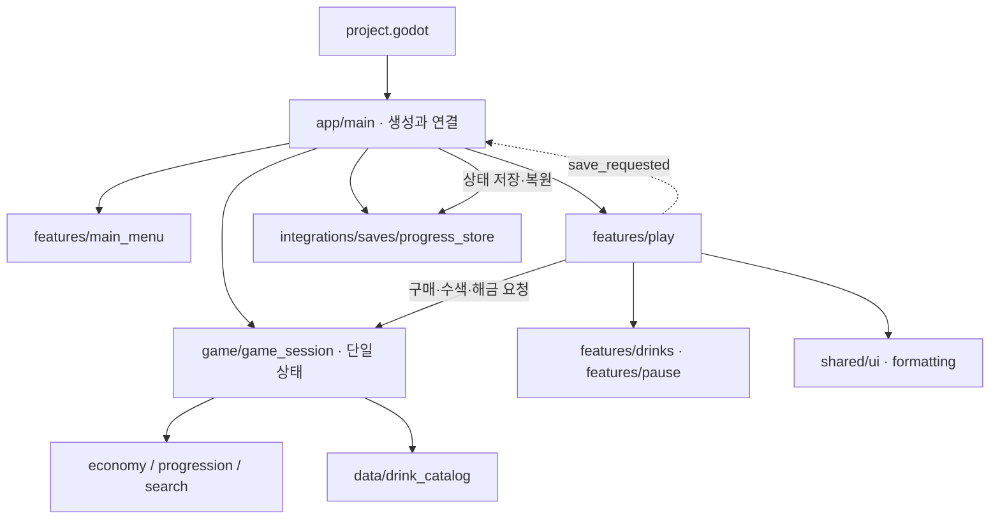

# 06. 폴더 구조·아키텍처

2026-10-20 사용자 승인 구조 전환을 반영한 실제 배치다. 상세 함수·호출자·검증 경로는 [코드 안내](07-codebase-guide.md), 코드 품질 검사는 [개발 규칙](02-development-rules.md)을 따른다. 기획·디자인 SSOT는 계속 Notion·Penpot이다.

## 실제 폴더 구조

```text
clicker/
├── project.godot
├── src/
│   ├── app/main.tscn, main.gd      # 시작·화면 전환·세션과 저장 연결
│   ├── game/
│   │   ├── game_session.gd         # 실제 진행 변경의 단일 진입점
│   │   ├── progress_state.gd       # 진행·게임 타이머 상태
│   │   ├── economy/economy_rules.gd
│   │   ├── progression/drink_rules.gd
│   │   ├── search/search_rules.gd
│   │   └── automation/facility_rules.gd # 시설 차감·생산·수집 규칙
│   ├── features/
│   │   ├── main_menu/             # 메뉴 씬·입력·표시
│   │   ├── play/                  # 플레이 씬·입력·화면 갱신
│   │   │   └── effects/           # 동전·배출·피버·알림·셰이더
│   │   ├── penpot/                    # 실제 화면이 참조하는 원본 그래픽·손님 파츠
│   ├── drinks/                # 음료·능력 씬·스크립트
│   │   ├── facilities/             # 시설 구매·관리·강화와 손님 표현
│   │   ├── settings/               # 원본 설정 화면·입력
│   │   └── pause/                 # 독립 일시정지 씬·스크립트
│   ├── shared/
│   │   ├── ui/themes/             # 공통 테마·상태별 스타일
│   │   ├── ui/icons/              # 공통 UI 이미지
│   │   ├── ui/design_view.gd       # 원본 메타데이터로 네이티브 UI 연결
│   │   ├── ui/cursor_theme.gd      # 엔진 전역 커서
│   │   └── formatting/amount_format.gd
│   ├── data/                      # drink_catalog.gd · customer_poses.gd
│   └── integrations/
│       ├── saves/progress_store.gd
│       └── settings/preferences_store.gd # 기기별 설정 파일·오디오/창/로케일
├── assets/                        # 기존 공유 이미지·음료·폰트
│   ├── penpot/                    # 실제 화면이 참조하는 원본 그래픽·손님 파츠
│   ├── drinks/
│   └── fonts/                     # 글꼴·라이선스·출처
├── tests/
│   ├── features/                  # 실제 씬·입력·진행 통합 회귀
│   ├── integrations/              # 저장 필드·정규화·이전 저장 회귀
│   └── support/game_fixture.gd    # 테스트 세션·임시 저장 연결
├── tools/                         # 개발 생성기·설명, import 제외
├── design/                        # Penpot 연결 안내·필요한 자료, import 제외
├── docs/                          # 규칙·구조·운영 안내, import 제외
├── .codex/pave/
└── .claude/
```

파일은 기능별로 모으고 씬·스크립트·전용 리소스를 가까이 둔다. 공유 UI는 테마·아이콘·커서로 구현되어 있으며, 별도 공유 씬이 필요해질 때만 `components/`를 만든다. Steam·모바일·번역·외부 플러그인 폴더는 실제 기능 도입 때 생성한다. 사용하지 않는 빈 디렉터리와 전달 전용 클래스를 만들지 않는다.

## 책임·의존성

| 영역 | 책임·허용 의존성 | 금지하는 의존성·소유권 |
| --- | --- | --- |
| app | 메뉴·Play 생성, 세션/저장 주입, 저장 결과·종료 연결 | 가격·보상 공식과 별도 진행 원장 |
| game | 세션의 진행 검증·변경, 규칙과 카탈로그 사용 | Control·씬 노드·테마·FileAccess·외부 SDK |
| features | 주입된 세션에 요청하고 상태를 표시; 공유 UI·데이터 사용 | 별도 잔액·해금 원장, 직접 저장/플랫폼 호출, 다른 화면 내부 노드 탐색 |
| shared/ui | 테마·아이콘·커서, 기능에 독립적인 공통 표현 | 특정 화면이나 게임 세션 역참조 |
| shared/formatting | 정확한 금액·축약 표시의 공통 변환 | 잔액·구매 가격 변경 |
| data | 상품 키·에셋·비용·선행 조건 정의 | 세션·UI 인스턴스 참조, 두 번째 상품 원본 |
| integrations/saves | 세션 데이터 직렬화·이전 저장 정규화·파일 검사·백업 | 보상/가격 계산·화면 제어·플레이 진행의 독립 소유 |
| tools | 단일 카탈로그를 읽어 임시 미리보기 생성 | 런타임 의존, 채택 씬·테마 자동 덮어쓰기 |

`game_session.gd`는 `progress_state.gd`를 상속한다. 상태 객체를 따로 복제해 동기화하는 구조가 아니며 세션 객체 하나가 상태와 변경 권한을 가진다. 화면은 세션을 참조하고 음료 화면에는 표시용 스냅샷을 전달한다. 게임 규칙은 `RefCounted` 기반으로 씬 트리 없이 사용할 수 있다.

## 실행·상태 흐름



- 구매: Play가 일시정지·열린 화면·연출 입력 차단을 확인 → 세션이 가격·잔액·진행 중 구매를 검사하고 차감·구매 횟수·획득을 갱신 → Play의 저장 요청을 앱이 동기 처리 → 기존 배출 연출 → 세션이 피버를 시작한다. 획득을 연출 종료 때 다시 지급하지 않는다.
- 해금: 음료 화면이 index를 signal로 요청 → 세션이 범위·중복·선행 조건·비용을 다시 검사하고 빈캔·해금을 갱신 → 표시 갱신·저장 요청. 선택·호버는 진행을 바꾸지 않는다.
- 일시정지: pause 씬은 ESC·저장·종료 요청을 내보낸다. Play가 현재 정보창과 pause 상태에 맞게 처리하므로 pause가 부모의 InfoOverlay를 직접 찾지 않는다.
- 시설: Play가 세션에 delta를 전달하고, 세션의 automation 규칙이 차감·생산·드롭 소멸·수집을 갱신한다. 시설 UI와 손님 관절 연출은 결과만 표현한다. 시설 상태는 `facilities.alley`에 저장하며 다른 스테이지의 상품 인덱스로 재사용하지 않는다.
- 기기 설정: Preferences autoload가 `user://settings.cfg`와 오디오 버스·창 모드·로케일을 소유한다. 진행 저장 및 향후 Steam Cloud와 분리한다.
- 저장: 앱이 저장소를 생성하고 Play의 요청과 연결한다. 테스트 fixture도 같은 세션/저장 경계를 연결한다. 실패 결과는 화면으로 전달하고 기존 종료 차단 동작을 유지한다.
- 표현: 선택·호버·연출 Tween·레이아웃은 화면 소유다. 골드·빈캔·획득·해금·구매 진행·피버 남은 시간은 세션 소유다. 화면은 타이머를 직접 차감하지 않고 세션에 delta와 차단 여부를 전달한다.

화살표는 호출·생성·요청을 뜻한다. 게임이 UI를 import하거나 파일 I/O를 호출하는 양방향 의존을 허용하는 그림이 아니다. 외부 연결은 필요한 객체와 signal을 앱에서 직접 연결하며 미사용 DI 컨테이너·이벤트 버스·전역 매니저를 추가하지 않는다.

## 파일 배치·공유 규칙

1. 기존 구현을 먼저 찾고 같은 책임이면 해당 소유자를 확장한다. 새로운 독립 책임이 있을 때만 파일을 나눈다.
2. 기능 전용 씬·리소스는 `features/<feature>/`, 게임 규칙은 `game/<domain>/`, 외부 파일/SDK 접근은 `integrations/<capability>/`에 둔다.
3. 실제로 여러 기능이 같은 의미로 쓰는 UI·스타일·표시만 shared로 올린다. 기능별 복사본이나 범용 utils/helpers/managers 폴더를 만들지 않는다.
4. 새 경로·책임·호출자·기존 구현을 쓰지 못하는 이유를 변경 계획에 명시한다. 형식적으로 파일 수를 늘리거나 모든 로직을 한 파일로 몰아넣지 않는다.
5. 이동 시 `res://`, UID/import 메타데이터, PackedScene·signal·노드 경로, 테스트와 안내를 함께 갱신한다. 단순 이동한 이미지·폰트·라이선스 내용은 바꾸지 않는다.

## 보존한 계약·후속 경계

- 기존 `user://progress.cfg`, progress 키·타입 처리·상한·이전 음료 변환·카탈로그 순서/인덱스·새 게임 백업 경로를 유지한다. 스키마를 새로 정의하거나 진행 데이터를 이동하지 않는다.
- 기존 테마·상태별 스타일·그림·폰트·화면 수치와 동작을 재사용한다. Penpot의 현재 게임 화면·에셋을 네이티브 씬과 원본 그래픽으로 적용한다. 현재 Play 씬의 이전 비표시 노드 이름이 남아 있더라도 새 공유 UI의 정규 예시로 확대하지 않는다.
- `tools/build_scenes.py`는 이전 레이아웃 미리보기 전용이다. `.godot/scene_previews/`에만 출력하며 현재 런타임 카탈로그를 읽는다. 별도 drinks.json 원본은 제거했다.
- 루트의 기존 `node_2d.tscn`은 이번 실행 경로 밖의 파일이며 새 기능 진입점으로 사용하지 않는다. 관련 없는 기존 파일을 구조 전환 명목으로 삭제하지 않았다.
- PC 로컬+Steam Cloud 방향, PC·모바일의 별도 진행, 첫 버전 비목표는 [PRODUCT 요약](../PRODUCT.md)과 Notion을 따른다. Steam Cloud·모바일 계정·복구 정책·로그 운영은 구현/확정된 것으로 간주하지 않는다. 토큰·자격 증명은 문서·로그·저장소에 남기지 않는다.

## Linked Sources

| Source | Owns | Not covered | Evidence paths |
| --- | --- | --- | --- |
| [코드 안내](07-codebase-guide.md) | 실제 함수·공유 소유자·회귀 테스트 | 제품 기획 원본 | src/, tests/ |
| [개발 규칙](02-development-rules.md) | 재사용·파일 생성·품질·Git | 실제 실행 성공 증거 | AGENTS.md, docs/02-development-rules.md |
| [검증 안내](05-quality-rules.md) | 검증 명령·결과·한계 | 제품 기획의 전체 동등성 | tests/, project.godot |
| [Notion](https://app.notion.com/p/3fcb6b9ead24800aa7bce8a1e1b045de), [PRODUCT](../PRODUCT.md) | 제품·플랫폼·저장 범위 | 코드 폴더 배치 | PRODUCT.md |
| [Godot 프로젝트 구성](https://docs.godotengine.org/en/stable/tutorials/best_practices/project_organization.html)·[씬 구성](https://docs.godotengine.org/en/stable/tutorials/best_practices/scene_organization.html) | 구성 원칙의 공식 참고 | 이 프로젝트의 디렉터리 지정 | src/ |
